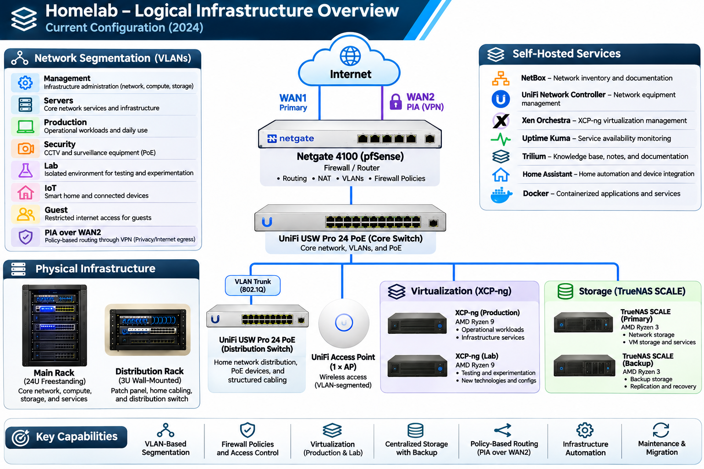

# Homelab Infrastructure

This repository documents the architecture, implementation, and evolution of my personal homelab, including the technologies I've explored, the infrastructure I've built, and the technical challenges I've encountered along the way.

## Overview

In 2020, I began designing and installing network infrastructure throughout my home to establish a hands-on learning environment for networking, infrastructure engineering, virtualization, storage, and systems administration.

What started as an educational project has evolved into an increasingly complex homelab. Over the years, I've designed, built, and expanded the environment through multiple generations of hardware, software, and network architecture.

My goal has been to gain practical experience with enterprise networking and infrastructure technologies while exploring different areas of information technology to determine where I want to focus my professional development.

## Homelab Evolution

### Version 1 — Initial Infrastructure (2020)

The first phase focused on establishing the physical network infrastructure and building a foundation for experimentation.

I planned, installed, and terminated ten Cat6 network drops throughout my home, along with cabling for eight Power over Ethernet (PoE) security cameras.

I converted an existing coat closet into a dedicated network closet to centralize the infrastructure. The original installation used an 11U wall-mounted equipment rack.

The initial network consisted of:

- **Firewall/Router:** Netgate SG-3100 running pfSense
- **Switching:** Cisco SG220-26P managed PoE switch
- **Wireless:** Apple AirPort wireless access points
- **Storage:** Two FreeNAS Mini systems running FreeBSD-based TrueNAS CORE
- **Compute:** Four surplus workstations used for bare-metal Linux server installation, configuration, and testing
- **Remote Management:** Raspberry Pi 4 configured as a PiKVM

As the environment developed, I began experimenting with Proxmox virtualization, including Linux containers (LXC) and virtual machines.

### Version 2 — Network and Infrastructure Redesign (January–May 2023)

Between January and May 2023, I completed the first major infrastructure upgrade. This was a progressive redesign focused on improving network performance, flexibility, and reliability.

I replaced the Cisco switch and Apple AirPort access points with UniFi managed switching and wireless equipment, managed through a self-hosted UniFi Network Controller.

I also upgraded the firewall from the Netgate SG-3100 to the Netgate 4100, increasing network throughput and providing six physical network interfaces for greater flexibility in network design, segmentation, and connectivity.

The physical infrastructure underwent a significant redesign. I replaced the original 11U wall-mounted rack with a 24U freestanding rack and installed a separate 3U wall-mounted vertical rack for the home's permanent structured cabling.

The 3U rack houses the patch panel and a dedicated distribution switch connected to the core top-of-rack switch through an 802.1Q VLAN trunk. This arrangement separates permanent building cabling from the main equipment rack, improving cable management, maintainability, and flexibility for future upgrades.

During this period, several surplus workstations began experiencing hardware failures. I progressively replaced them with a GEEKOM mini PC and a Supermicro X9SRL-F-based server, providing a more capable foundation for virtualization and infrastructure services.

### Version 3 — Compute and Storage Modernization (2024)

Throughout 2024, I completed the second major infrastructure upgrade, focusing on compute capacity, virtualization, and storage. Rather than replacing everything at once, I progressively transitioned to newer hardware and expanded the environment's capabilities.

I replaced the Supermicro server with two AMD Ryzen 9-based systems running XCP-ng, establishing two dedicated virtualization environments: production and lab.

Separating these environments allows me to experiment with new technologies and configurations without directly affecting production services. It also provides opportunities to practice virtual machine migration, infrastructure maintenance, and server upgrades while minimizing service downtime.

I also replaced the original FreeNAS Mini systems with two AMD Ryzen 3-based storage servers. Both systems initially ran FreeBSD-based TrueNAS CORE and were subsequently upgraded to Linux-based TrueNAS SCALE.

These upgrades expanded the homelab's capabilities and provided a more flexible foundation for virtualization, storage, and future networking projects.

## Current Infrastructure

Today, my homelab operates as a segmented network supporting production services, infrastructure management, virtualization, centralized storage, and an isolated environment for experimentation.

### Network Architecture

The network uses pfSense for routing, firewall policies, and VLAN segmentation. Managed UniFi switching provides connectivity between the core network, structured cabling distribution, wireless devices, and infrastructure systems.

Separate network segments allow me to isolate workloads, control inter-network communication, and test different networking configurations.

### Virtualization and Storage

Two independent XCP-ng environments support production workloads and lab experimentation. This separation allows me to evaluate new technologies, test configurations, and practice migrations and maintenance without unnecessarily disrupting production services.

Primary and backup TrueNAS SCALE systems provide centralized storage and data protection for the environment.

### Infrastructure Management

I use several self-hosted applications to manage, monitor, and document the infrastructure:

- **NetBox:** Network inventory and infrastructure documentation
- **UniFi Network Controller:** Network equipment management
- **Xen Orchestra:** Virtualization management
- **Uptime Kuma:** Service availability monitoring
- **Trilium:** Technical notes and knowledge management
- **Home Assistant:** Automation and device integration
- **Docker:** Containerized application hosting

## Infrastructure Overview

The following diagram provides a high-level overview of the current infrastructure, including network connectivity, virtualization, storage, and supporting services. It illustrates representative network segments while omitting IP addresses, detailed firewall policies, and physical port assignments.

## Future Development

My current interests are focused on expanding my networking knowledge and developing practical experience with advanced routing and cloud infrastructure.

Areas I plan to explore include:

- BGP and OSPF routing
- Virtualized networks using private autonomous systems
- Advanced network segmentation and routing policies
- Hybrid cloud networking
- Infrastructure automation
- Cloud architecture and engineering
